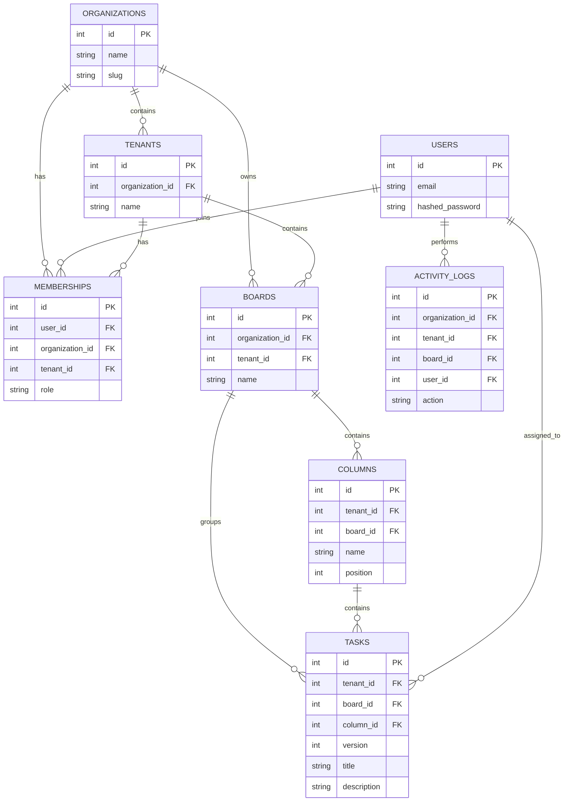

# CollabKanban Database ER Diagram

The database contains eight primary application tables.

## Design notes

- Organizations are the top-level isolation boundary.
- Tenants represent branches or workspaces inside organizations.
- Memberships connect users to organizations and tenants with roles.
- Boards belong to a specific organization and tenant.
- Columns belong to boards.
- Tasks belong to boards and columns and carry a version number for optimistic concurrency.
- Activity logs record task-related actions and the user responsible.

Composite foreign keys and unique constraints in the SQLAlchemy models enforce important organization and tenant relationships.

The diagram is a conceptual overview. The SQLAlchemy models and Alembic migration are the authoritative schema definitions.